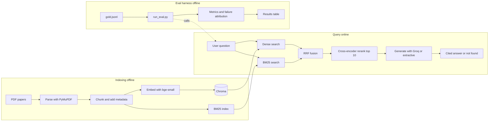

# Hybrid RAG + Eval Harness: Sprint Plan and Architecture

## 1. Project summary

**Problem statement**
Researchers lose time finding specific methods and results across RAG papers. We build a hybrid-retrieval Q&A system with cited answers and an eval harness that measures which retrieval strategy works, where it fails, and what it costs in latency.

**One-line pitch**
A RAG system that is measured, not just demoed: it cites its sources, says "not found" when the papers don't answer, and shows where it fails.

**Two deliverables**

| Deliverable | For | Purpose |
|---|---|---|
| RAG Q&A system | Users (researchers) | Cited answers in seconds |
| Eval harness | Builders and reviewers | Proof of quality, failure analysis, regression gate |

**Build approach (open decision, see section 10)**
Either upgrade the MIT-licensed reference repo `AbhishekRK41/rag-eval-system` (keep the license notice and credit it) or build from scratch. The module layout below mirrors the reference repo, so both paths use the same design.

---

## 2. Goals, non-goals, success criteria

**Goals**
1. Hybrid retrieval (BM25 + dense, RRF fusion) plus a cross-encoder reranker
2. Cited answers with an honest "not found" path
3. A verified gold set and a one-command harness that outputs a results table
4. Automatic failure attribution by pipeline stage
5. A retrieval-lift measurement against an LLM-only baseline
6. Runs on a laptop CPU with free-tier LLM access

**Non-goals for Sprint 1**
Hosting, multi-user auth, GPU use, fine-tuning, UI polish beyond a clear demo.

**Success criteria** (placeholders: set exact targets after the first baseline run, and report misses honestly)

| Claim | Metric | Target |
|---|---|---|
| Finds the right evidence | Recall@5 | TBD after baseline |
| Answers are correct | Key-fact match | TBD after baseline |
| Does not guess | Abstention accuracy on unanswerable questions | TBD after baseline |
| Fast on CPU | p95 end-to-end latency | TBD after baseline |
| Hybrid is worth it | Gain over dense-only baseline | Report the measured gap |
| RAG helps over the LLM alone | Retrieval lift | Report the measured gap |

---

## 3. Users and access

| Side | Who | Uses | Access |
|---|---|---|---|
| User | Researcher | Q&A system | Streamlit page, later the `/query` API |
| Builder | You, maintainers | Eval harness | CLI (`python eval/run_eval.py`), CI gate, `results/` files |
| Reviewer | Recruiters, engineers | Repo and demo | README, results table, short screen recording |

Users never see chunks, scores, or metrics. They see a question box, a cited answer, and a "not found" state. The harness keeps those answers correct over time.

---

## 4. Architecture



### 4.1 Components

| Stage | Responsibility | Tool | Key decision |
|---|---|---|---|
| Parse | PDF to text per page | `pymupdf` | Inspect output; tables will be messy |
| Chunk | Split text, attach metadata | Recursive splitter, about 400 tokens, 50 overlap | Compare 256 vs 512 later |
| Embed | Chunk and query vectors | `sentence-transformers`, `bge-small-en-v1.5` | Small model for CPU |
| Dense index | Vector search | `chromadb` | Store paper, page, chunk id |
| Sparse index | Keyword search | `rank_bm25` | Same chunks as dense |
| Fusion | Merge two ranked lists | RRF, score = sum of 1 / (60 + rank) | Ranks only, no score normalisation |
| Rerank | Re-score top candidates | CrossEncoder `ms-marco-MiniLM-L-6-v2` | Rerank top 10 only (CPU cost) |
| Generate | Grounded answer with citations | Groq free tier; extractive fallback | Strict "answer only from context" prompt |
| Eval | Score every config on the gold set | `pandas`, `numpy`, own metrics | Retrieval metrics need no LLM |

Model names are starting points. Confirm they download and run on your machine, and let eval numbers decide whether to change them.

### 4.2 Run modes

| Mode | LLM | Use |
|---|---|---|
| `retrieval_only` | No | Returns top chunks with sources. Free and fast |
| `extractive` | No | Returns the best sentence from the top chunk |
| `full_rag` | Yes | LLM writes a cited answer |
| `llm_only` | Yes | Baseline with no retrieval, used to measure retrieval lift |

### 4.3 Retrieval configs (ablation matrix)

| ID | Dense | BM25 | RRF | Rerank |
|---|---|---|---|---|
| C1 | yes | no | no | no |
| C2 | no | yes | no | no |
| C3 | yes | yes | yes | no |
| C4 | yes | yes | yes | yes |

Stretch variants: chunk size 256 vs 512, final k of 3 vs 5.

### 4.4 Cross-cutting design rules
1. **Corpus is pluggable.** Paths and settings come from `corpus.yaml`, so a second corpus needs only a new config and a gold file.
2. **Cache everything.** Embeddings and every LLM response are cached to disk keyed by input hash. Reruns cost nothing.
3. **Retrieval metrics first.** Run all configs without the LLM. Generate and judge only on the best 2-3 configs.
4. **Secrets in `.env`, never committed.** `.env.example` documents the variables.
5. **Log latency per stage** (retrieve, rerank, generate) and the number of LLM calls per query.

---

## 5. Data design

**Repo structure**
```
rag-harness/
  corpus.yaml
  data/papers/  data/text/
  gold/gold.jsonl
  src/
    ingest.py  chunk.py  index.py  retrieve.py  rerank.py  generate.py
  eval/
    metrics.py  run_eval.py  attribute_failures.py
  results/
  tests/
  app.py                      # Streamlit demo
  README.md  requirements.txt  .env.example
  (Sprint 2) api/main.py  Dockerfile  .github/workflows/eval.yml
```

**Parsed page row** (`data/text/<paper>.jsonl`)
```json
{"paper": "dpr", "title": "...", "arxiv": "2004.04906", "page": 3, "text": "..."}
```

**Chunk row**
```json
{"chunk_id": "dpr_p3_c2", "paper": "dpr", "page": 3, "text": "...", "n_tokens": 380}
```

**Gold row** (`gold/gold.jsonl`)
```json
{
  "id": "q001",
  "type": "fact | number | method | comparison | unanswerable",
  "question": "<question you can verify in the paper>",
  "answerable": true,
  "gold_answer": "<short verified answer>",
  "key_facts": ["<phrase that must appear>"],
  "gold_sources": [{"paper": "<key>", "page": 0}]
}
```
Unanswerable questions use `"answerable": false` and empty `gold_sources`.

**Gold set rules**
- 30 questions for Sprint 1, mix: about 10 fact or number, 8 method, 5 comparison across papers, 5 unanswerable, 2 spare
- Claude may draft candidates from chunks, but **you verify every answer against the paper**
- Check that unanswerable questions really are not answered in the corpus
- Fix the gold set before tuning anything

**Results output**
`results/run_<timestamp>.json` (per-question logs) and `results/results_table.md`.

---

## 6. Evaluation design

**Metrics**

| Group | Metric | Needs LLM |
|---|---|---|
| Retrieval | Recall@5, Hit rate@5, MRR, nDCG@5 | No |
| Answer | Key-fact match (normalised phrase check) | No |
| Answer | Citation match (cited paper and page vs gold) | No |
| Answer | Abstention accuracy (refuses unanswerable, answers answerable) | Mostly no |
| Answer | Faithfulness (claims supported by context) | Yes, sampled |
| System | Latency p50 and p95 per stage, LLM calls per query | No |
| Comparison | Retrieval lift = key-fact match (full_rag) minus key-fact match (llm_only) | Yes |

**Failure attribution** (applied to every wrong answer, first matching rule wins)

| Stage | Rule |
|---|---|
| Parse | Gold fact is not present in the parsed page text |
| Chunk | Gold fact is not fully inside any single chunk |
| Retrieve | Gold chunk is not in the candidate pool before reranking |
| Rerank or cutoff | Gold chunk was in the pool but not in the final top-k |
| Generate | Gold chunk was in the context but the answer is wrong |
| Abstention | An unanswerable question was answered, or an answerable one was refused |

**Judge handling**
- Use a model different from the answer model where possible
- Judge a sample of about 15-30 answers, cache every judgement
- Hand-label the same sample and report agreement between judge and you

**Reporting rules**
- Every README claim points to a metric or a file
- Report configs where an intervention did not help, and say why
- State the gold set size next to every table

---

## 7. Sprint plan

Time estimates are rough and assume focused work on a laptop.

### Sprint 1: MVP, ships tomorrow (about 11 hours)

**Goal:** a working cited Q&A system, a verified 30-question gold set, and a results table for four configs.

| Block | Time | Tasks | Done when |
|---|---|---|---|
| 1. Ingest | 1.5 h | Verify 8 paper IDs, run `ingest.py`, run `check_text.py`, read samples | 8 `.jsonl` files, text reads in order |
| 2. Retrieval | 2 h | Chunking with metadata, embeddings, Chroma, BM25, RRF, `retrieve(query, mode, k)` | All four configs return ranked chunks |
| 3. Gold set | 2.5 h | Write and verify 30 questions with answers, key facts, sources | `gold.jsonl` validated |
| 4. Harness | 2 h | `metrics.py`, `run_eval.py`, latency timers, results table | One command prints the table for C1-C4 |
| 5. Generation | 1.5 h | Grounded prompt, citations, "not found" rule, cache, `llm_only` baseline; generate on best 2 configs; judge a sample | Answer metrics and retrieval lift |
| 6. Demo and docs | 1.5 h | `attribute_failures.py`, Streamlit screen, README, screenshots, short recording | Repo ready to share |

**Definition of done**
- [ ] `python eval/run_eval.py` reproduces the results table
- [ ] README contains the table, failure breakdown, and one finding
- [ ] Demo shows a cited answer and a "not found" case
- [ ] No keys in the repo
- [ ] A few `pytest` tests cover metrics and RRF

**Cut order if time runs short:** judge sample, nDCG, Streamlit polish, recording. Never cut the gold set. If only 20 good questions are ready, ship with 20 and say so.

### Sprint 2: Productionise (about 1-2 days)
- FastAPI `/query`, `/health`, `/eval-report`
- Dockerfile and docker compose
- GitHub Actions: run the eval on pull requests, fail when a metric drops below baseline
- Unit tests for retrieval and metrics
- Query caching and structured logs

**Done when:** a pull request that degrades retrieval fails CI, demonstrated once.

### Sprint 3: Generalise and deepen (about 1-2 days)
- Second corpus (for example MRL/AMU documents, your notes, or university ordinances) with about 20 verified questions
- Counterfactual grounding test: edit a number in a document copy and confirm the answer changes
- Judge validation: report agreement with your hand labels
- Query transformations (rewrite, multi-query, HyDE) tested through the harness
- Chunk size and k ablations

**Done when:** the same harness produces comparable tables on both corpora.

### Sprint 4: Showcase (about half a day)
- Public README with architecture diagram, results, failure analysis, limitations
- 60-90 second screen recording or GIF
- Optional hosted demo with extractive mode as default
- Short write-up of the main findings

---

## 8. Risks and mitigations

| Risk | Impact | Mitigation |
|---|---|---|
| Gold set takes longer than planned | Delays everything | Start drafting questions during Block 1; ship with fewer verified questions rather than sloppy ones |
| PDF text is jumbled (two-column layout, tables) | Parse and chunk failures | Inspect early; adjust extraction; note limits in README |
| LLM already knows famous papers | Inflates results | `llm_only` baseline and retrieval lift |
| Free-tier rate limits | Blocks generation runs | Cache, retrieval-only evals first, generate on top configs only, extractive fallback |
| Slow reranker on CPU | Latency | Rerank top 10 only; report latency as a result |
| Small gold set | Noisy conclusions | State n beside every table; avoid strong claims on small differences |
| Dense retriever or reranker underperforms | Weak headline | Report honestly with a hypothesis |

---

## 9. Showcase plan

| Item | Content |
|---|---|
| Streamlit app | Cited answer, "not found" state |
| CLI harness | Results table for C1-C4 |
| README | Problem, architecture, results, failure breakdown, limitations |
| Recording (2 min) | Problem (10 s), demo (40 s), harness (40 s), one finding (20 s), failures (10 s) |

If hosting a public demo, store keys in the platform's secrets, and default to a mode that does not spend LLM quota.

---

## 10. Open decisions and assumptions

| Item | Status |
|---|---|
| Fork and upgrade `rag-eval-system` vs build from scratch | Open. Forking is faster; building teaches more. Credit the reference either way |
| Paper IDs | Taken from memory; verify each download matches the intended title |
| Model names | Starting points; confirm they work on your CPU |
| Groq free-tier limits | Sources disagree; check your own console |
| Success targets | Set after the first baseline run |
