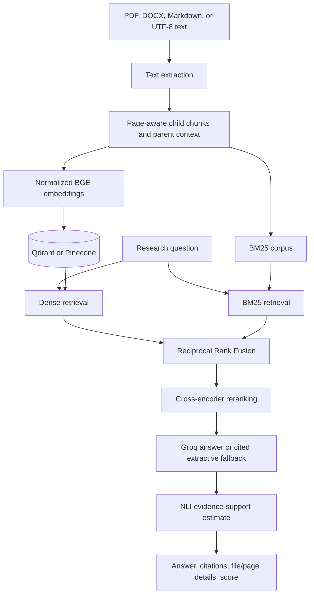

# Research Paper Assistant: Architecture and Roadmap

## Product

Help a reader understand one or more uploaded research papers. A user can ask about a paper's research question, claimed contributions, study design, datasets, results, comparisons, and stated limitations. Answers cite the retrieved chunks; PDF citations include page numbers. The application can retrieve across multiple uploaded papers, which supports cross-paper comparison when the evidence is present.

The project also includes a retrieval evaluation harness. The harness is a developer tool: it compares retrieval configurations against a reviewed gold set. The checked-in corpus is fictional smoke data and cannot support product quality claims.

## Current architecture



### Implemented components

| Stage | Implementation |
|---|---|
| Parsing | PyMuPDF extracts PDF text by page. DOCX paragraphs and tables, Markdown, and UTF-8 text are supported. |
| Chunking | 300-word child chunks. Groups of up to four children share parent context. PDF page boundaries are retained. |
| Dense retrieval | `BAAI/bge-small-en-v1.5` embeddings stored in Qdrant or optional Pinecone. |
| Sparse retrieval | BM25 over the same child chunks, restored from an atomic JSONL corpus snapshot. |
| Fusion | Reciprocal Rank Fusion with `k=60`. |
| Reranking | `cross-encoder/ms-marco-MiniLM-L-6-v2` scores the fused candidate set. |
| Generation | Groq model configured with `GROQ_MODEL`; defaults to `openai/gpt-oss-20b`. Without a Groq key or on generation failure, the first sentence from the top parent chunk is returned with a citation. |
| Citation checks | Every generated factual sentence must have a retrieved chunk citation. Unsupported or invalid citations fall back to an extractive answer. |
| Evidence scoring | `cross-encoder/nli-deberta-v3-small` estimates entailment between each claim and its cited parent text. Empty answers have no score. |
| API and UI | FastAPI for query/ingestion and Streamlit for upload, questions, citations, and evidence status. |
| Storage | Qdrant can use memory, a local path, or a remote URL. The API persists BM25 chunks as JSONL. Docker Compose uses a named volume. |
| Evaluation | C1 dense, C2 BM25, C3 hybrid RRF, and C4 hybrid RRF with reranking; reports Recall@k, hit rate, MRR, nDCG, and retrieval latency. |

## Data contracts

A chunk stores `chunk_id`, `doc_id`, child `text`, `parent_text`, `source_name`, and optional one-based `page_number`. The same serialized chunk is used in the vector metadata/payload and the saved sparse corpus. Chunk identifiers include a content-and-path hash to avoid collisions between same-named files. Re-ingesting an unchanged source is idempotent; a changed file at the same source path replaces its older chunks. Use distinct filenames to retain multiple paper versions.

Each answer citation refers to a chunk ID in the retrieved context. The UI maps that ID back to a filename and, when available, a PDF page. NLI checks the claim against the citation's parent text, not against the whole retrieved context.

## Quality boundaries

- The smoke corpus is fictional and has seven hand-authored retrieval questions. It proves only that the evaluation path is wired correctly.
- There is no reviewed real-paper benchmark yet, and CI does not gate scientific answer correctness.
- Retrieval metrics do not measure whether generated answers preserve nuance, units, uncertainty, or author attribution.
- NLI evidence scores are estimates; scientific claims still need review against the paper.
- Scanned PDFs, equations, figures, and complex PDF tables need OCR or specialized extraction. Current parsing is text-only.
- DOCX, Markdown, and text citations identify the file and chunk, not a page.
- Uploads require `ADMIN_API_KEY`. Query routes are open by default; deployment should add access control at the application or trusted proxy layer.

## Roadmap

### 1. Build a real paper evaluation set

Choose a small, openly licensed collection of papers and manually verify every question, answer, source chunk, and page. Include factual questions, methods, numerical results, cross-paper comparisons, conflicting results, and unanswerable questions. Track paper IDs and benchmark version. Keep the synthetic smoke set for CI wiring.

### 2. Measure answer quality

Add answer-level metrics: key-fact coverage, citation source/page match, unsupported-claim rate, and abstention precision/recall. Save per-question retrieved chunks, generated answer, citations, and latency so failures can be assigned to parsing, chunking, retrieval, reranking, generation, or abstention.

### 3. Improve paper structure extraction

Retain PDF metadata, headings, abstract and section boundaries. Evaluate chunk sizes and overlap with the reviewed gold set. Add OCR and equation/table extraction only with dedicated fixtures and evaluation cases.

### 4. Harden deployment

Add query authentication and user/corpus isolation before exposing the app to multiple users. Add request IDs, structured latency logs, rate limits, retention controls, and a documented backup/restore procedure for vector and corpus storage.

### 5. Keep experiments reproducible

Record model IDs, chunking settings, retrieval parameters, corpus version, and dependency versions with each benchmark result. Add a lock file after selecting a supported deployment environment and verify CPU memory/latency costs on the target host.

## Commands

From the repository root:

```bash
uvicorn rag_hybrid.src.api.app:app --reload
streamlit run rag_hybrid/scripts/app_streamlit.py
python rag_hybrid/scripts/ingest.py --source rag_hybrid/data/papers
python -m rag_hybrid.eval.run_eval --chunks rag_hybrid/eval/data/sample_chunks.jsonl --gold rag_hybrid/eval/data/sample_gold.jsonl
```

See the root [README](../README.md) for installation, environment variables, API examples, and Docker Compose setup.
